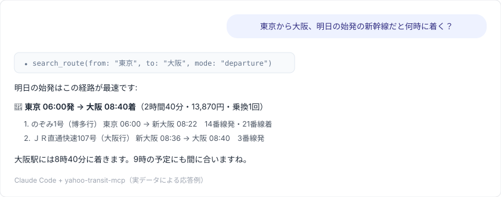
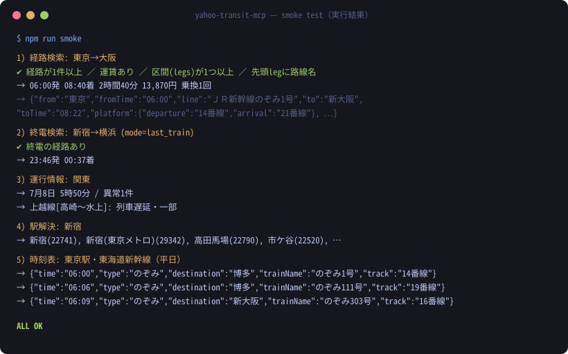
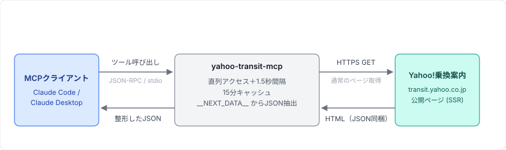

# yahoo-transit-mcp

[](https://github.com/groundcobra009/yahoo-transit-mcp/actions/workflows/ci.yml)
[](LICENSE)
[](package.json)

[Yahoo!乗換案内](https://transit.yahoo.co.jp/) の**非公式** MCP（Model Context Protocol）サーバーです。Claude Code / Claude Desktop などのMCPクライアントから、日本の電車の**経路検索・終電・運行情報・駅時刻表**を調べられるようになります。

> **Unofficial** MCP server for Yahoo! Transit (transit.yahoo.co.jp), a Japanese transit directions service. Provides route search (incl. last/first train), realtime service disruption info, and station timetables as MCP tools. No authentication required. Japanese rail network only.



## できること

| ツール | 説明 |
|---|---|
| `search_route` | 経路検索。出発・到着時刻指定のほか、**終電**（`mode: last_train`）・**始発**（`mode: first_train`）に対応。時刻・所要時間・運賃・乗換回数・区間ごとの路線/番線/リアルタイム遅延情報を返す |
| `get_train_status` | 運行情報（遅延・運転見合わせ）。8地方エリア別。路線名で絞り込むと平常運転かどうかも確認できる |
| `search_station` | 駅名から駅コードを検索。候補が1件なら路線・方面一覧も返す |
| `get_timetable` | 駅の発車時刻表。路線・方面・平日/土曜/日祝・時間帯で絞り込み |

認証・APIキー・環境変数は**一切不要**です（ログイン不要の公開ページのみを利用するため）。

## クイックスタート

Node.js 18以上が必要です。

### Claude Code

プロジェクトの `.mcp.json` に追加します:

```json
{
  "mcpServers": {
    "transit": {
      "type": "stdio",
      "command": "npx",
      "args": ["-y", "github:groundcobra009/yahoo-transit-mcp"]
    }
  }
}
```

またはCLIで:

```bash
claude mcp add transit -- npx -y github:groundcobra009/yahoo-transit-mcp
```

### Claude Desktop

`claude_desktop_config.json` に追加します:

```json
{
  "mcpServers": {
    "transit": {
      "command": "npx",
      "args": ["-y", "github:groundcobra009/yahoo-transit-mcp"]
    }
  }
}
```

### クローンして使う場合

```bash
git clone https://github.com/groundcobra009/yahoo-transit-mcp.git
cd yahoo-transit-mcp
npm ci && npm run build
# → MCPクライアントには command: "node", args: ["/path/to/yahoo-transit-mcp/dist/index.js"] で登録
```

登録後、「明日の朝9時までに大阪駅に着きたい」「山手線は遅れてる？」「終電何時？」のように話しかけるだけで使えます。

## 出力例

`search_route(from: "東京", to: "大阪")` の実際の返り値（抜粋）:

```json
{
  "routes": [
    {
      "no": 1,
      "depart": "06:00",
      "arrive": "08:40",
      "duration": "2時間40分",
      "fare": "13,870円",
      "transfers": 1,
      "badges": ["早"],
      "legs": [
        {
          "from": "東京", "fromTime": "06:00",
          "line": "ＪＲ新幹線のぞみ1号", "destination": "博多行",
          "to": "新大阪", "toTime": "08:22",
          "platform": { "departure": "14番線", "arrival": "21番線" },
          "fare": "8,910円"
        },
        {
          "from": "新大阪", "fromTime": "08:36",
          "line": "ＪＲ直通快速107号",
          "to": "大阪", "toTime": "08:40",
          "platform": { "departure": "3番線" }
        }
      ]
    }
  ]
}
```

スモークテスト（`npm run smoke`）で4ツールすべてを実データ検証できます:



## 動作原理

公式APIは存在しないため、このサーバーは**公開ページに埋め込まれた構造化データ**を読み取ります。



Yahoo!乗換案内はNext.jsで構築されており、サーバーサイドレンダリングされた各ページには、画面表示用の全データが `<script id="__NEXT_DATA__">` タグ内のJSONとして同梱されています（Reactのハイドレーション用・Next.jsの標準動作）。このサーバーはブラウザと同じようにページをGETし、このJSONだけを抽出してパースします。

- Yahooのバックエンドエンドポイントを直接叩きません（リバースエンジニアリング・トークン取得なし）
- CSSセレクタに依存しないため、見た目のリニューアル程度では壊れません
- ページ構造が大きく変わって解析できなくなった場合は、`MarkupChangedError` がツール結果として明示的に返ります（黙って誤った経路を返すことはありません）

## ツールリファレンス

### `search_route` — 経路検索

| パラメータ | 型 | 説明 |
|---|---|---|
| `from` / `to` | string（必須） | 出発・到着の駅名または地名 |
| `via` | string[] | 経由駅（最大3つ） |
| `date` / `time` | string | `YYYY-MM-DD` / `HH:MM`（省略時は現在日時） |
| `mode` | enum | `departure`（出発・既定）/ `arrival`（到着）/ `first_train`（始発）/ `last_train`（終電） |
| `sort` | enum | `time`（到着が早い・既定）/ `fare`（安い）/ `transfers`(乗換少ない) |
| `ticket` | enum | `ic`（既定）/ `normal`（きっぷ） |
| `useShinkansen` ほか | boolean | 新幹線 / 有料特急 / 飛行機 / 高速バスの利用可否（既定: true） |

駅名が曖昧な場合は候補リスト（`didYouMean`）を返します。

### `get_train_status` — 運行情報

| パラメータ | 型 | 説明 |
|---|---|---|
| `area` | enum | `北海道` `東北` `関東`（既定）`中部` `近畿` `中国` `四国` `九州` |
| `line` | string | 路線名の部分一致フィルタ（例: `山手線`）。異常がなければ平常運転と分かる |
| `onlyTroubled` | boolean | `false` で平常運転の路線名一覧も返す |

### `search_station` — 駅検索

| パラメータ | 型 | 説明 |
|---|---|---|
| `query` | string（必須） | 駅名（例: `新宿`） |

### `get_timetable` — 駅時刻表

| パラメータ | 型 | 説明 |
|---|---|---|
| `station` | string（必須） | 駅名または駅コード |
| `line` / `direction` | string | 路線名・方面の部分一致。曖昧なら候補一覧がエラーとして返るので絞り込んで再実行 |
| `dayType` | enum | `weekday`（既定）/ `saturday` / `holiday` |
| `hourFrom` / `hourTo` | number | 返す時間帯（0〜27時台） |

## アクセスマナー（実装で強制）

相手サーバーに負荷をかけないため、以下をコードで強制しています:

- 全リクエストの**直列化**＋**1.5秒以上の間隔**（`src/fetch.ts`）
- URL単位の**15分キャッシュ**
- 10秒タイムアウト・リトライは通信エラー時の1回のみ

対話的な利用を想定したツールです。**ポーリング・一括クロール・大量取得には使わないでください。**

## 開発

```bash
npm ci          # 依存インストール
npm run build   # TypeScriptビルド（dist/）
npm run lint    # 型チェック（tsc --noEmit）
npm run smoke   # 実サイトに対する動作確認（約6リクエスト・直列）
npx tsx scripts/try-route.ts 東京 大阪 2026-07-10 09:00 arrival  # 単発の経路検索
```

CIでは lint / build のみ実行します。`smoke` は実サイトへアクセスするため、リリース前の手動ゲートとしてローカルで実行してください。

## 免責事項

- 本プロジェクトは**個人による非公式ツール**であり、LINEヤフー株式会社とは一切関係ありません（非公認・非提携）。「Yahoo!」「Yahoo!乗換案内」はサービスの識別のためにのみ言及しており、商標は各権利者に帰属します
- 公開ウェブページの解析に基づくため、**サイト側の変更により予告なく動作しなくなる可能性**があります
- 取得した情報の正確性は保証されません。実際の運行は公式情報を確認してください
- 本ソフトウェアの利用は**自己責任**です。利用者は対象サービスの利用規約を自身で確認し、過度なアクセス・商用利用・取得データの再配布を行わないでください

## ライセンス

[MIT](LICENSE) © keitaro ([groundcobra009](https://github.com/groundcobra009))
